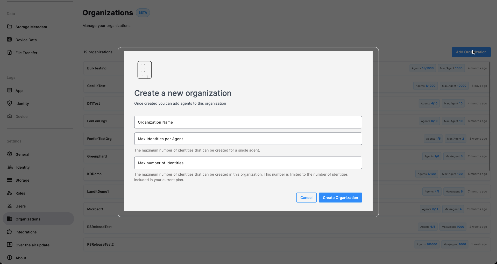
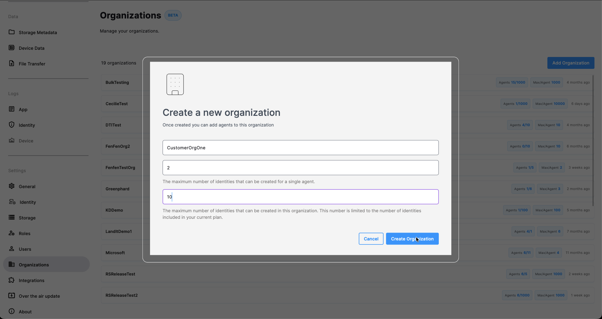
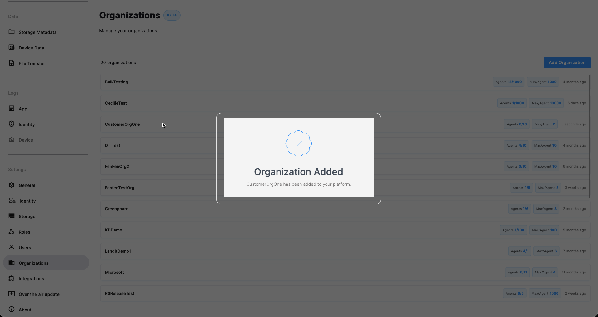
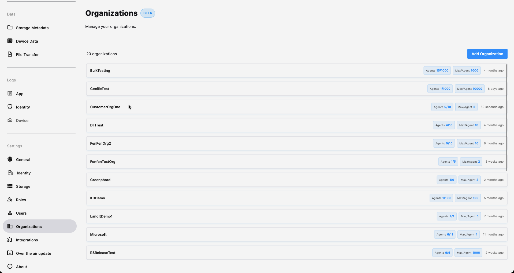
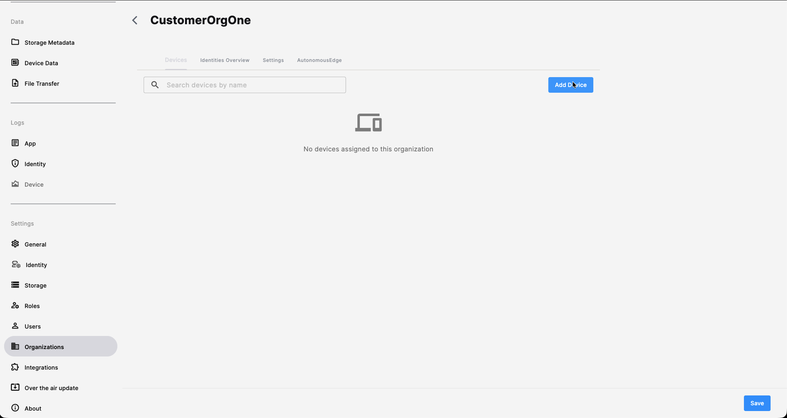
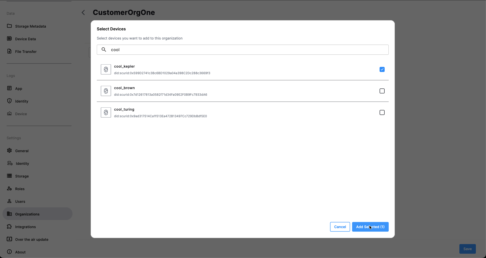
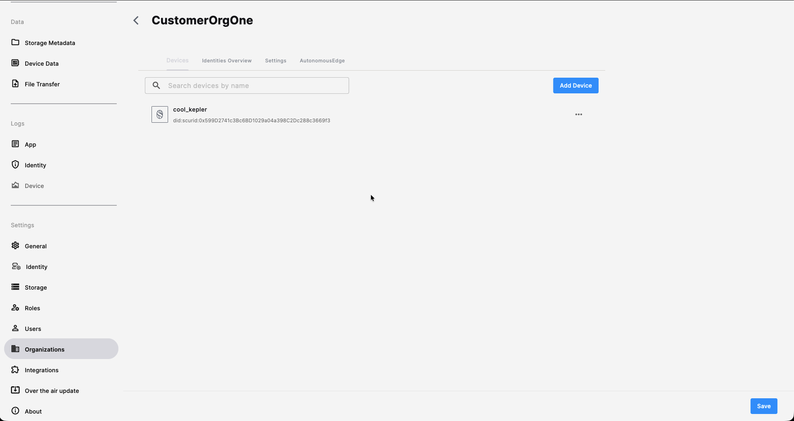
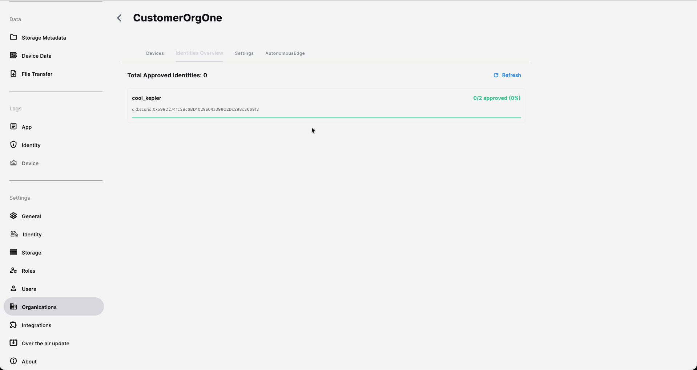

Using Scurid Server and App you can create organizations.

### Pre-requisites
1. Ensure that you have successfully installed and configured Scurid Server and App.
2. Ensure that you have successfully onboarded the user.

## Creating an Organization
1. Open Scurid App and login with your passphrase created during the onboarding process. 
2. Click on `Organizations` then click on `Add Organization` 
3. Fill in the required details and click on `Create Organization`. 
4. The organization is created and can be seen in the list of existing organizations. 

## Add device to Organization
1. Select an Organization from list of Organizations. 
2. Click on `Add Device` 
3. Search the device to be added through the search box.
4. Select the device. 
5. The device is now added to the Organization. !

## Check Identities allotment status
1. Select an Organization from list of Organizations. .
2. Click on `Identities Overview` 

## Update maximum identities limit for each agent
1. Select an Organization from list of Organizations. .
2. Click on `Settings` 
3. Update the count.
4. Click on the  `Save` button on the bottom right hand side.
5. Identities limit per agent is updated now!

## Delete Organization
1. Select an Organization from list of Organizations. .
2. Click on `Settings` 
3. Click on `Delete Organization` button.
4. Click on `Delete` button.
5. Organization is deleted!
