Using Scurid Server and App you can create and invite users in your organization to work with you.

### Pre-requisites
Ensure that you have successfully installed and configured Scurid Server and App.

## Creating and inviting a user
1. Open Scurid App and login with your passphrase created during the onboarding process. 
2. Click on `Settings` then `Users` and click on Add new user. 
3. Fill in the required details and click on `Invite`. 
4. The user will receive an email with an invite code valid for 24hrs. If the user fails to complete the invitation process within 24hrs, you can resend the invite code by filling up the invite form.

## Accepting an invite
1. Download the app from [Downloads](https://scurid.com/downloads)
2. Launch the app and toggle to `Sign into an existing server`
3. Click on 
4. Enter the server and port your were invited to and click on `Next`. 
5. Complete the form, including the invite code you received in your email and click on `Next`. 
6. Once done, app will reload to show the login page. Click on `Sign into an existing server` and login with your email and password you just created. 

## Add a Device User

# Add a Device User with Username and Password
1. Open Scurid App and login with your passphrase created during the onboarding process. 
2. Click on `Users`. 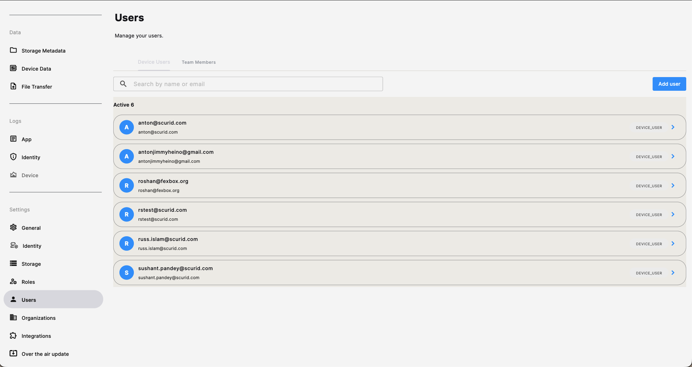
3. Click on `Add User` button, a pop up box will appear.
4. Select `With Username and Password`. 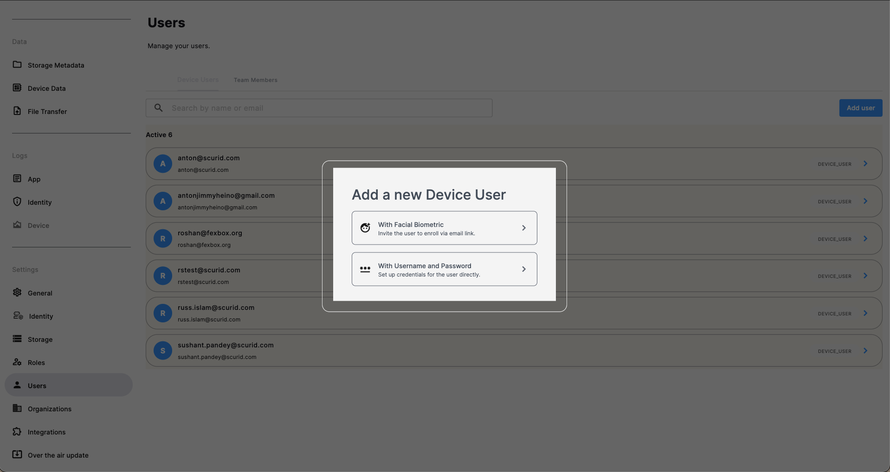
5. Fill up the user details and click on `Enroll` 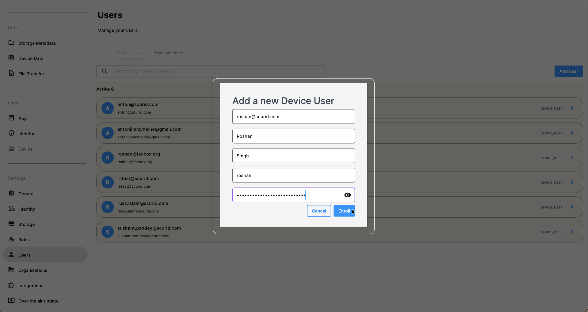
6. A confirmation message will appear and the user is enrolled. 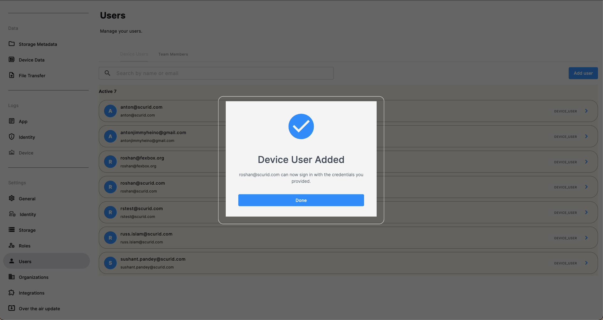
7. The newly added user can be seen in the list. 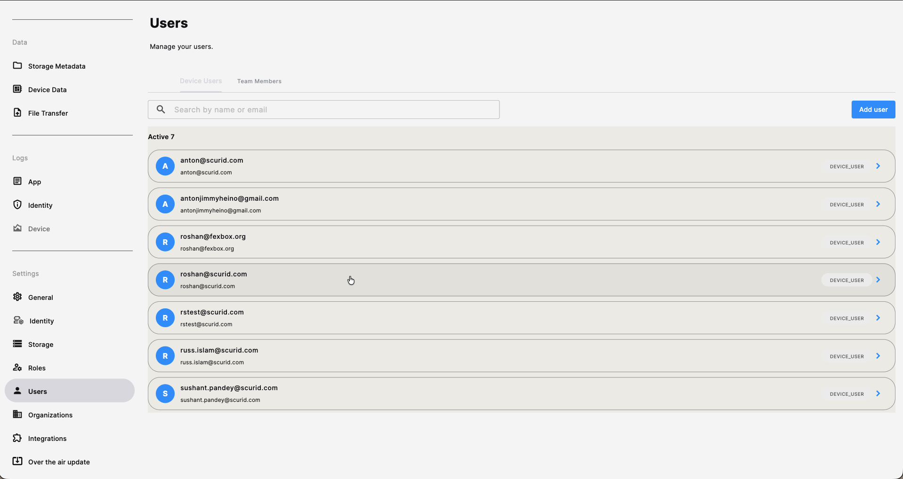

# Add a Device User with Biometrics
1. Open Scurid App and login with your passphrase created during the onboarding process. 
2. Click on `Users`. 
3. Click on `Add User` button, a pop up box will appear.
4. Select `With Facial Biometrics`. 
5. Fill up the form with details of the user and click `Enroll` . 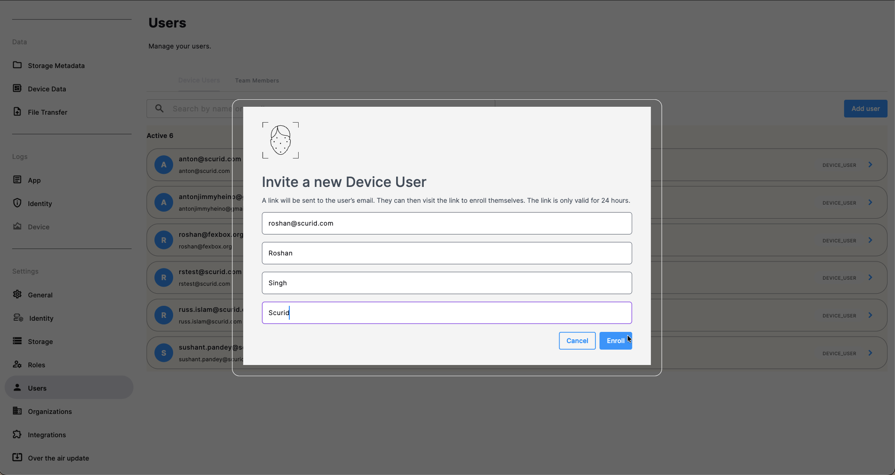
6. An invite will be delivered on the provided email. 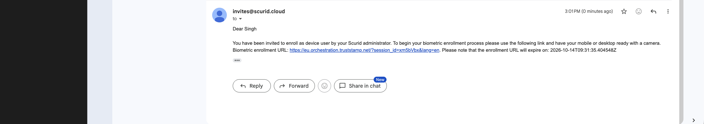.
7. Go to the link provided in the email and click on `Continue` . 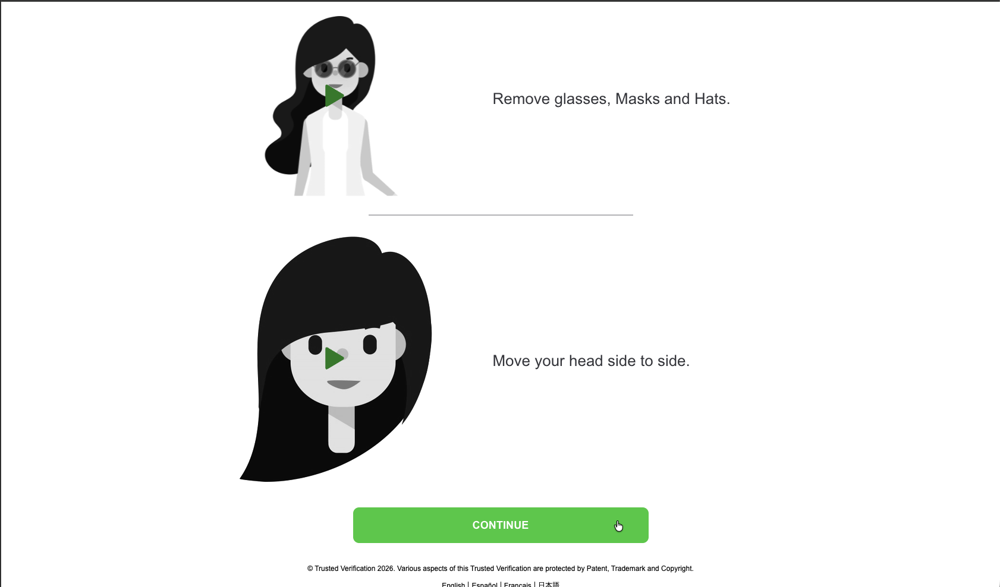.
8. Accept the terms and conditions by clicking on `Accept`. 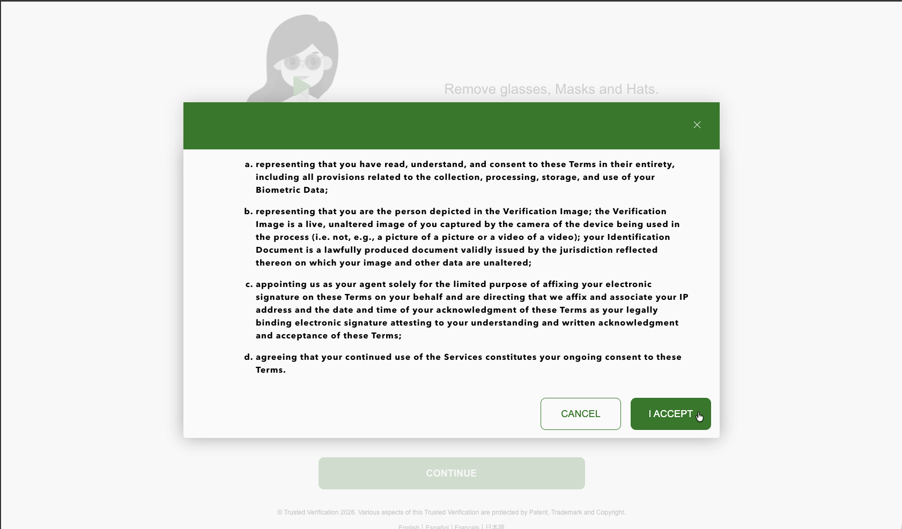.
9. Grant web camera access. .
10. Allow the portal to capture the user's facial biometrics. .
11. A confirmation message will be provided. 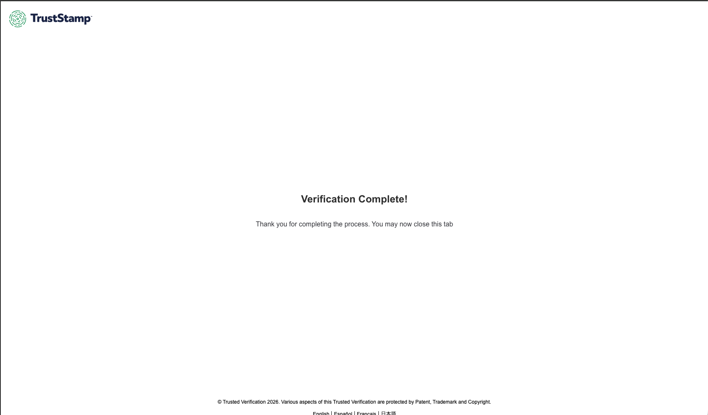.
12. The user shall now appear in the list of Device Users.

## Reset Password of a Device User
# Reset Password of a Device User with Username and Password
1. Open Scurid App and login with your passphrase created during the onboarding process. 
2. Click on `Users`. 
3. Select the user from the list of registered users.
4. Click on Reset Password. 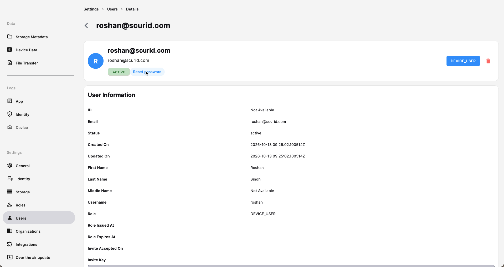
5. Click on Send Code. 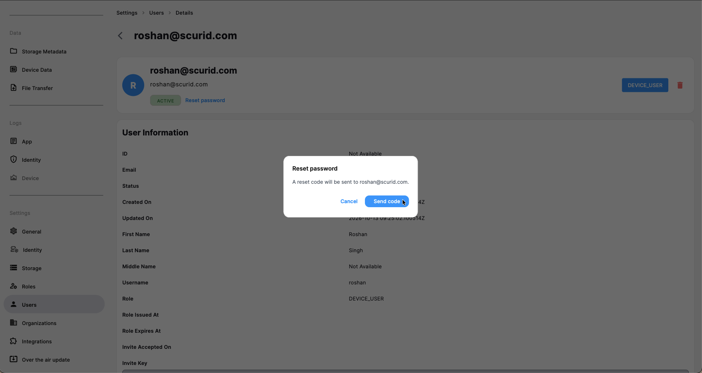
6. A code will be delivered on the registered email of the user.
7. Fill up the password reset form with new password and received code, and click on `Update Password` button. 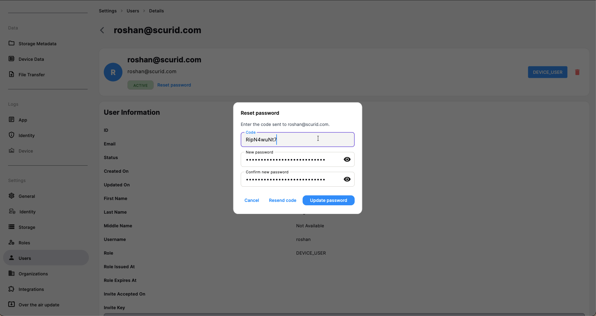
8. The password is reset now!

## Delete a Device User
1. Open Scurid App and login with your passphrase created during the onboarding process. 
2. Click on `Users`. 
3. Select the user from the list of registered users.
4. Click on delete icon on the top right hand side. 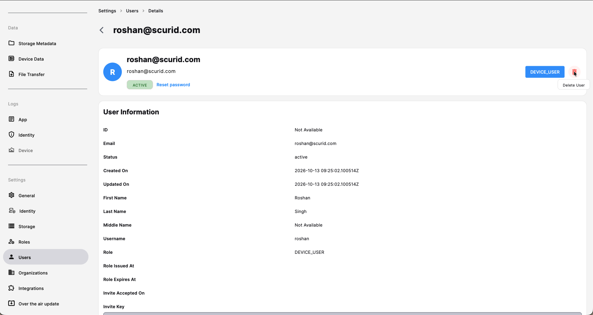
5. Click on `Confirm` button. 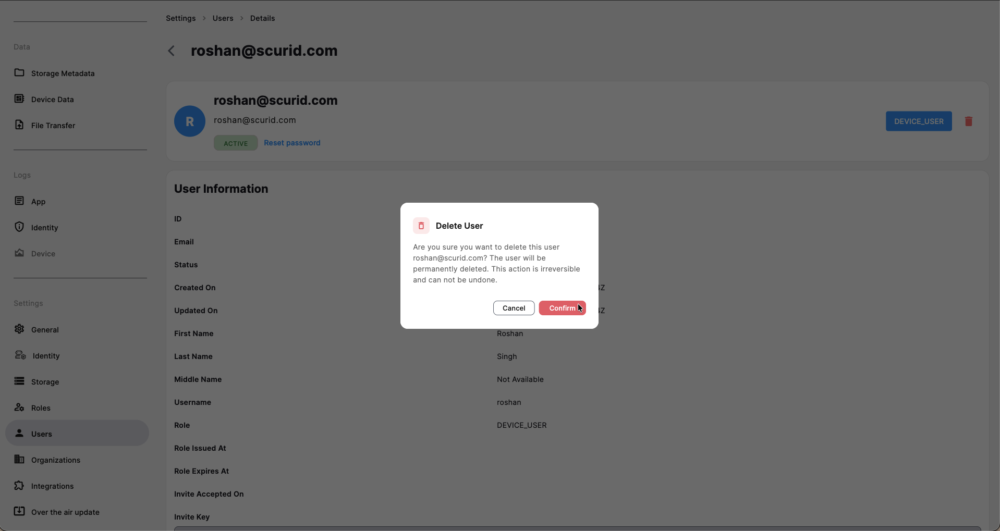
6. The user is deleted!

## Assign User to a Device
1. Open Scurid App and login with your passphrase created during the onboarding process. 
2. Click on `Agents` and select an agent to which the user has to be added. To select the agent, click on the agent modal. 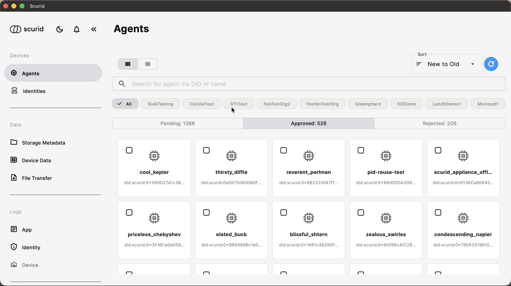.
3. Click on the `User Access` tab. 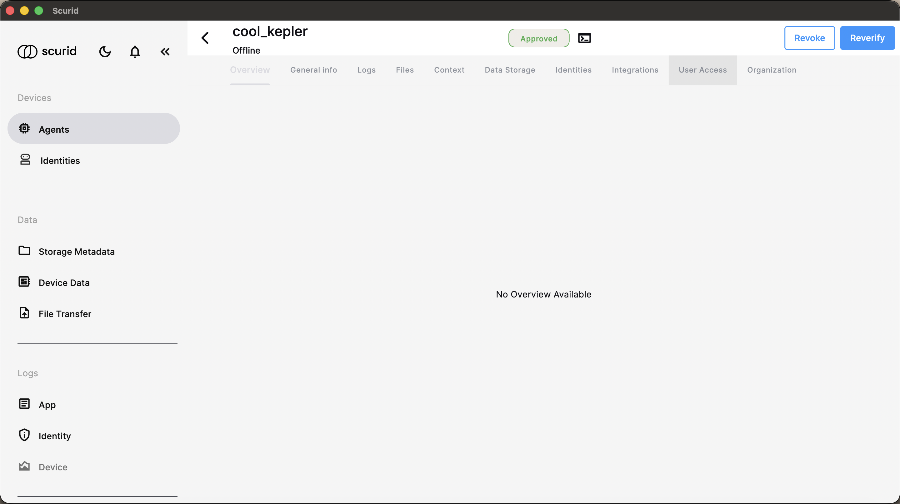.
4. A list of available users will be shown under `User Access` section.
5. Click on the addition icon available at the extreme right of the candidate user. .
6. The user is now added to the device. 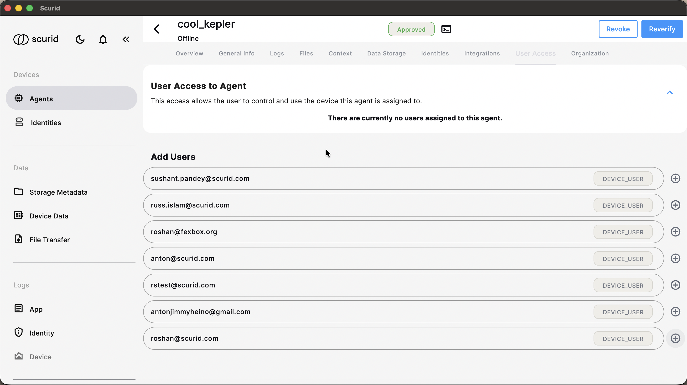.